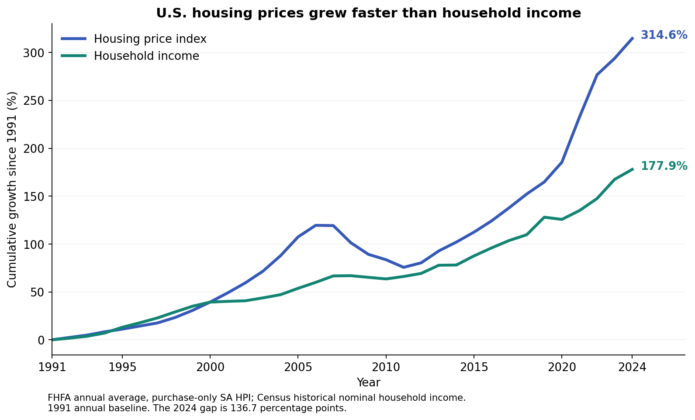

# Home Price v Median Income 1991 - 2024

## Interactive website: one U.S. income line

[Open the live explorer](https://rhyman7.github.io/Home_Price_v_Median_Income_1991-2024/). Every location now uses the **same U.S. median household income for all 34 years, 1991–2024**. Only housing changes with the selected location. Income dollar values and growth are identical across United States, states, and metro areas.

Growth gaps compare location housing growth with national income growth. Ratios compare location ACS home value with same-year national income. These are national-benchmark comparisons, not local-income or same-geography ACS affordability measures. CSV downloads and labels use this same definition.

Rebuild with `python build_explorer.py` and `python scripts/build_github_pages.py`. See `docs/national_income_comparison.md` for methodology. The site no longer displays local income; the underlying local-income datasets and earlier analytical reports below remain preserved as historical research and use their original methodology.

## Archived research and original local-income comparisons

The sections below describe the original analytical datasets, not the revised live site's national-income comparison. Local ACS pairs remain in `data/dollars/acs_dollar_comparison.csv`; historical metro income and its audits remain in `data/historical_metro_income/` and `docs/historical_metro_income_sources.md`. They are not used as income inputs by the current explorer.

## Verified annual rebuild (November 3, 2026)

Start with **`annual_comparison.ipynb`** for the corrected annual methodology, or open **`reports/annual_growth_explorer.html`** for an interactive offline chart. Select a national, state, or metro/division series; the notebook also provides a year/area table.

Reproduce the data from the pinned official FHFA snapshot:

```bash
python build_annual.py
python -m unittest discover -s tests -v
```

The rebuild retains 1991–2024 for the United States, 50 states, D.C., and 100 metro/division housing series. It averages all four seasonally adjusted quarters and rebases to the 1991 annual average. National/state nominal household income is joined by geography and year. Metro income growth since 1991 is explicitly unavailable. HPI measures price growth, **not dollar home prices**. The separate ACS view provides dollar home values and value-to-income ratios for available years; it does not supply a 1991 metro-income baseline.

Outputs are in `data/annual`, including a separate SQLite database and source/coverage report. Raw official data and its checksum are in `data/raw`. See `docs/annual_foundation_validation.md` for the source correction and validation.

**Historical project description below (the verified findings appear at the end):** the original notebooks, databases, and findings have been preserved. They use Q1 housing values and should not be cited as results of this annual rebuild. The superseded README conclusions are archived in `docs/historical_readme_findings.md`. The historical `index_nsa` field had 100 subtracted from every value; the new pipeline reads untouched official indices and stores growth separately.

The purpose of this project is to compare the cost of purchasing a home to the median income on a state by state basis between the years of 1991 and 2024. Data gathered from the Federal Housing Finance Agency (FHFA) and the United States Census Bureau will be used to make this determination. FHFA data will provide the change in the Housing Price Index (HPI), while the United States Census Bureau data will provide the median income data. First question is whether or not any state's median income has kept up with the rise in HPI. After that explore what states are closest and which are furthest. Additionally, have there been any nationwide trends during this timeframe?

## Installation

1. Clone the repository
```bash
  git clone https://github.com/rhyman7/Home_Price_v_Median_Income_1991-2024.git
```
2. After you have cloned the repository to your machine, navigate to the project folder in GitBash/Terminal.
```bash
cd [your_project_folder]
```
3. Create Virtual Environment, Activate, and Install Dependencies.

Windows
```bash
python -m venv venv
```
```bash
source venv/Scripts/activate
```
```bash
pip install -r requirements.txt
```

Linux/Mac
```bash
python3 -m venv venv
```
```bash
source venv/bin/activate
```
```bash
pip install -r requirements.txt
```
4. Open ```dataset_cleaning_hpi_income.ipynb``` for understanding of how data was cleaned and median income dataset was reshaped.
5. Open ```sql_and_visuals.ipynb``` for all plots and SQL database.
6. When finished with repo deactivate virtual environment.
Windows
```bash
deactivate
```

Linux/Mac
```bash
deactivate
```

## Data Sources
Federal Housing Finance Agency: https://www.fhfa.gov/data/hpi/datasets?tab=master-hpi-data(historical

United States Census Bureau: https://www.census.gov/data/tables/time-series/demo/income-poverty/historical-income-households.html
## Code Structure
The project is organized into data preparation, SQL querying, and visualization layers. Cleaned datasets are joined using state and year, enabling calculation of affordability metrics such as the gap between housing prices and income growth. Modular plotting functions allow flexible analysis by state and year, while a choropleth map provides geographic insights.
## Technology Used

*Python* – core programming language for analysis and development\
*Python Libraries* - Pandas, Numpy, Matplotlib, Plotly\
*Jupyter Notebook* – used for exploratory analysis and workflow documentation\
*SQLite* – simple relational database for local data storage and retrieval\
*VS Code* – development environment for coding and file organization\
*Git & GitHub* – used for version control and collaborative project sharing\
*Markdown* – used for writing notes, documentation, and explanations\
*AI* - Chat GPT was used for the ai_assist_animations.ipynb notebook

## Data Dictionary
Variables from hpi_clean.csv:
- hpi_type       (str)           Type of housing transaction  
- hpi_flavor     (str)           Methodologies to measure price change
- frequency      (str)           How often the data is collected       
- level          (str)           Level of agency resposible for data      
- place_name     (str)           State, city, or division data was collected for   
- place_id       (str)           Unique identifier for each area data is collected on     
- yr             (int64)         Year data was collected
- period         (int64)         Can refer to a year or month depending on the frequency data was collected
- index_nsa      (float64)       Number representing the HPI index for the period data was collected. Not seasonally adjusted
- index_sa       (float64)       Number representing the seasonally adjusted HPI

Variables for median_income_clean_w_change.csv
- place_name     (str)           State data was collected on
- yr             (int64)         Year data was collected
- median_income  (str)           Median income for the reported year
- change         (float64)       Percent change from the baseline of 1991

## Verified findings

Using the annual 1991 baseline, U.S. housing prices rose **314.6%** through 2024, while nominal median household income rose **177.9%**. The difference was **136.7 percentage points**. The national gap was largest in **2024** within this dataset, rather than peaking in 2022.

In 2024, cumulative housing growth exceeded income growth in **all 50 states**. This also occurred in **2005, 2022**. Illinois had income growth ahead of housing growth in 2021 and 2023, so the pattern was not uninterrupted after 2021.

The smallest 2024 state gaps were **Mississippi, Illinois, West Virginia, Iowa, Ohio**. The largest were **Montana, Colorado, Utah, Oregon, Idaho**. These rankings exclude D.C.

The separate 2024 ACS comparison reports a U.S. median owner-occupied home value of **$360,600** and median household income of **$81,604**, a **4.42×** ratio. Among the 50 states, **West Virginia** has the lowest point estimate (2.81×) and **Hawaii** the highest (8.69×). Among the 100 selected metro/division areas, the range runs from **Pittsburgh, PA** (2.98×) to **San Francisco-San Mateo-Redwood City, CA (MSAD)** (9.74×).

These are descriptive comparisons. They do not establish causes or measure mortgage-payment affordability. The ACS ratio compares two population medians and uses home values, not sale prices. Rankings use point estimates without significance testing.



## Coverage and interpretation

- Growth uses annual averages of all four seasonally adjusted FHFA quarters, rebased to 1991. Income uses the repository's historical Census current-dollar series. These are nominal measures. That preserved income source has not been refreshed against the latest release.
- Dollar comparisons use ACS 1-year B25077 and B19013 from the same year and geography. ACS income is not spliced into the historical growth series. U.S. 2024 historical income is $83,730, compared with ACS income of $81,604.
- National and state/DC ACS coverage is 2005–2019 and 2021–2024. Paired ACS home-value comparisons do not cover 1991–2004, and no standard ACS 1-year estimates exist for 2020. The separate household-income panel adds 129 verified observations for 1999–2004 across 27 metros; 30 are explicitly labeled constant-dollar estimates. Missing values remain missing.
- All 100 selected metro/division areas have paired dollar estimates in 2023–2024. Older coverage varies. Exact code matches do not guarantee unchanged boundaries; earlier metro geographies have not been harmonized. These are metro areas/divisions, not individual city boundaries or all U.S. metros.
- The explorer now includes a Household income view with earlier Census/ACS records, source labels, dollar years, and missing-data reasons. See `docs/historical_metro_income_sources.md` and `data/historical_metro_income/coverage_by_area.csv`.
- Metro income growth since 1991 is unavailable. State rankings exclude D.C.; the explorer still includes it.
- Source margins of error are retained in the dollar data. No ratio margin of error or ranking significance test has been calculated. Home values cover owner-occupied homes, while income covers households generally. Interest rates, down payments, taxes, insurance, and household-specific costs are not modeled.

Open [the interactive findings charts](reports/findings/interactive_findings.html), or read [the full findings and ranking tables](reports/findings/housing_income_findings.md). Rebuild the report and three charts with `python scripts/build_findings.py`.
