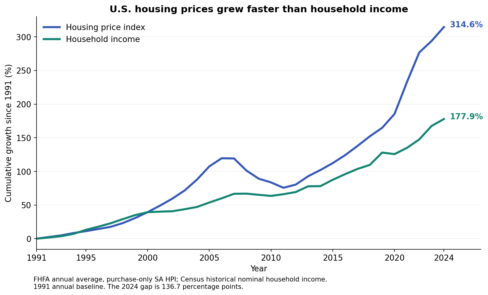
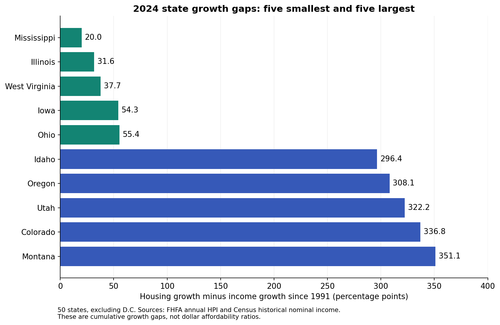
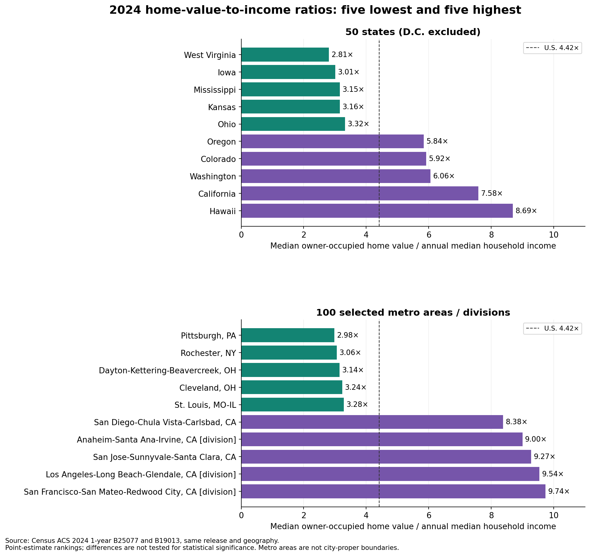

# Housing and income: verified findings, 1991–2024

[Open interactive charts](interactive_findings.html).

## Verified findings

Using the annual 1991 baseline, U.S. housing prices rose **314.6%** through 2024, while nominal median household income rose **177.9%**. The difference was **136.7 percentage points**. The national gap was largest in **2024** within this dataset, rather than peaking in 2022.

In 2024, cumulative housing growth exceeded income growth in **all 50 states**. This also occurred in **2005, 2022**. Illinois had income growth ahead of housing growth in 2021 and 2023, so the pattern was not uninterrupted after 2021.

The smallest 2024 state gaps were **Mississippi, Illinois, West Virginia, Iowa, Ohio**. The largest were **Montana, Colorado, Utah, Oregon, Idaho**. These rankings exclude D.C.

The separate 2024 ACS comparison reports a U.S. median owner-occupied home value of **$360,600** and median household income of **$81,604**, a **4.42×** ratio. Among the 50 states, **West Virginia** has the lowest point estimate (2.81×) and **Hawaii** the highest (8.69×). Among the 100 selected metro/division areas, the range runs from **Pittsburgh, PA** (2.98×) to **San Francisco-San Mateo-Redwood City, CA (MSAD)** (9.74×).

These are descriptive comparisons. They do not establish causes or measure mortgage-payment affordability. The ACS ratio compares two population medians and uses home values, not sale prices. Rankings use point estimates without significance testing.

### State growth extremes

| State | Housing growth | Income growth | Gap (pp) |
|---|---:|---:|---:|
| Mississippi | 207.3% | 187.4% | 20.0 |
| Illinois | 195.8% | 164.1% | 31.6 |
| West Virginia | 210.5% | 172.8% | 37.7 |
| Iowa | 253.7% | 199.4% | 54.3 |
| Ohio | 225.7% | 170.3% | 55.4 |
| Montana | 581.0% | 229.9% | 351.1 |
| Colorado | 574.9% | 238.1% | 336.8 |
| Utah | 593.4% | 271.2% | 322.2 |
| Oregon | 505.2% | 197.1% | 308.1 |
| Idaho | 509.0% | 212.6% | 296.4 |

### 2024 dollar comparisons

| Area | Home value | Household income | Value / income |
|---|---:|---:|---:|
| United States | $360,600 | $81,604 | 4.42× |
| District of Columbia | $733,400 | $109,707 | 6.69× |

### States: five lowest ratios

| Area | Home value | Household income | Value / income |
|---|---:|---:|---:|
| West Virginia | $170,800 | $60,798 | 2.81× |
| Iowa | $227,300 | $75,501 | 3.01× |
| Mississippi | $186,500 | $59,127 | 3.15× |
| Kansas | $238,700 | $75,514 | 3.16× |
| Ohio | $239,800 | $72,212 | 3.32× |

### States: five highest ratios

| Area | Home value | Household income | Value / income |
|---|---:|---:|---:|
| Hawaii | $875,900 | $100,745 | 8.69× |
| California | $759,500 | $100,149 | 7.58× |
| Washington | $602,200 | $99,389 | 6.06× |
| Colorado | $574,600 | $97,113 | 5.92× |
| Oregon | $497,500 | $85,220 | 5.84× |

### Selected metro areas / divisions: five lowest ratios

| Area | Home value | Household income | Value / income |
|---|---:|---:|---:|
| Pittsburgh, PA | $230,300 | $77,214 | 2.98× |
| Rochester, NY | $234,100 | $76,453 | 3.06× |
| Dayton-Kettering-Beavercreek, OH | $228,600 | $72,711 | 3.14× |
| Cleveland, OH | $234,700 | $72,532 | 3.24× |
| St. Louis, MO-IL | $268,300 | $81,679 | 3.28× |

### Selected metro areas / divisions: five highest ratios

| Area | Home value | Household income | Value / income |
|---|---:|---:|---:|
| San Francisco-San Mateo-Redwood City, CA (MSAD) | $1,451,000 | $148,994 | 9.74× |
| Los Angeles-Long Beach-Glendale, CA (MSAD) | $866,500 | $90,845 | 9.54× |
| San Jose-Sunnyvale-Santa Clara, CA | $1,528,500 | $164,801 | 9.27× |
| Anaheim-Santa Ana-Irvine, CA (MSAD) | $1,037,200 | $115,229 | 9.00× |
| San Diego-Chula Vista-Carlsbad, CA | $914,700 | $109,132 | 8.38× |

## Coverage and interpretation

- Growth uses annual averages of all four seasonally adjusted FHFA quarters, rebased to 1991. Income uses the repository's historical Census current-dollar series. These are nominal measures. That preserved income source has not been refreshed against the latest release.
- Dollar comparisons use ACS 1-year B25077 and B19013 from the same year and geography. ACS income is not spliced into the historical growth series. U.S. 2024 historical income is $83,730, compared with ACS income of $81,604.
- National and state/DC ACS coverage is 2005–2019 and 2021–2024. Paired ACS home-value comparisons do not cover 1991–2004, and no standard ACS 1-year estimates exist for 2020. The separate household-income panel adds 129 verified observations for 1999–2004 across 27 metros; 30 are explicitly labeled constant-dollar estimates. Missing values remain missing.
- All 100 selected metro/division areas have paired dollar estimates in 2023–2024. Older coverage varies. Exact code matches do not guarantee unchanged boundaries; earlier metro geographies have not been harmonized. These are metro areas/divisions, not individual city boundaries or all U.S. metros.
- The explorer now includes a Household income view with earlier Census/ACS records, source labels, dollar years, and missing-data reasons. See `docs/historical_metro_income_sources.md` and `data/historical_metro_income/coverage_by_area.csv`.
- Metro income growth since 1991 is unavailable. State rankings exclude D.C.; the explorer still includes it.
- Source margins of error are retained in the dollar data. No ratio margin of error or ranking significance test has been calculated. Home values cover owner-occupied homes, while income covers households generally. Interest rates, down payments, taxes, insurance, and household-specific costs are not modeled.

## Reproduction and source trail

Run `python scripts/build_findings.py` from the repository environment. Inputs are `data/annual/comparison_annual.csv` and `data/dollars/acs_dollar_comparison.csv`. This build checks unique keys, recomputes all annual growth and gap values from their levels and 1991 baselines, and recomputes all 2,640 available ACS ratios. Source input hashes and complete rankings are saved in `findings_audit.json`.

Source definitions and acquisition details: `docs/annual_foundation_validation.md` and `docs/dollar_sources_report.md`. Original publishers: [FHFA HPI](https://www.fhfa.gov/data/hpi) and [Census ACS summary files](https://www.census.gov/programs-surveys/acs/data/summary-file.html). The analysis uses the project's saved source snapshots, not a new live-data refresh.
